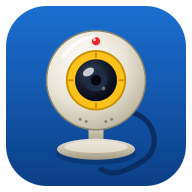

<p align="center"></p>

# Macawlink

Use your Android phone as a **webcam and microphone** for Windows. Plug it in by USB and every
app (Teams, Zoom, Meet, OBS, Discord, the Windows Camera app) sees **“Macawlink Camera”** like a
real USB webcam. The phone's microphone feeds a virtual mic.

- **Android app:** Kotlin, Camera2 feeding the hardware H.264/HEVC encoder (zero copy), PCM mic, foreground service
- **Windows receiver:** Go (standard library only) plus one native DLL that holds the Windows 11 virtual camera, the Media Foundation decoder and WASAPI output
- **Tweakable live** from the phone or the PC: resolution (480p, 720p, 1080p), 15–60 fps, bitrate (or auto), H.264/HEVC, lens, zoom, torch, stabilization, mirror, sample rate (16–48 kHz), mono/stereo, echo/noise/gain processing, PC-side gain, plus presets

## Setup (one time)

1. **PC: Windows 10 or 11.** Unzip `macawlink-windows.zip` anywhere and run `macawlink.exe`.
   Accept the setup prompt. It installs to *Program Files* and registers *Macawlink Camera* (admin, once).
   - **Windows 11** uses the built-in virtual camera, so it works in every app, including the Camera app.
   - **Windows 10** uses a DirectShow camera (the same approach as OBS Virtual Camera). It shows up in Chrome, Edge, Zoom, Teams, Discord and OBS; restart the browser once after setup. The Windows 10 *Camera* app only lists physical webcams.
2. **Virtual mic:** install the free [VB-Audio Virtual Cable](https://vb-audio.com/Cable/).
   Macawlink plays the phone mic into *CABLE Input*. In your call app choose **CABLE Output** as the microphone.
   An own *Macawlink Microphone* driver is on the roadmap.
3. **Phone: Android 10+.** Install `macawlink.apk`. Turn on *Developer options → USB debugging*.
4. Plug the phone in and tap **Allow** on the USB-debugging prompt. Macawlink opens on the phone by itself.
   Tap **Start streaming** the first time to grant camera and mic permission.
5. In Teams/Zoom/Meet/OBS pick **Macawlink Camera** and **CABLE Output**.

Hold the phone in landscape; the picture is turned upright automatically. The tray icon (left
click) opens the settings page at `http://127.0.0.1:47801`.

## Build

```bash
# Windows receiver: cross-compiles from Linux/macOS too (needs Go 1.22+ and `pip install ziglang`)
cd windows && ./build.sh          # -> windows/dist/ (exe, native DLL, adb)

# Android app (JDK 17+, Android SDK)
cd android && ./gradlew assembleRelease   # -> app/build/outputs/apk/release/app-release.apk
```

Test the receiver without a phone: `fakephone.exe -h264 clip.h264`, then `macawlink.exe -addr 127.0.0.1:47800`.

## Docs
- [Architecture](docs/ARCHITECTURE.md)
- [Wire protocol](docs/PROTOCOL.md)
- [Roadmap](docs/ROADMAP.md)

## Layout
```
android/       Kotlin app
windows/       Go receiver (cmd/, internal/), native/ (C++ DLL), vmic-driver/ (Phase 3)
proto-golden/  wire-format fixtures checked by both the Go and the Kotlin tests
assets/icon/   orb-cam icon (SVG, PNG, ICO)
docs/
```

## Troubleshooting
| Symptom | Fix |
|---|---|
| Tray says *Tap “Allow USB debugging”* | Unlock the phone and accept the prompt (tick *Always allow*). |
| *Found phone — open Macawlink* | Open the app and tap **Start streaming**. |
| Windows 10: camera missing in the browser | Close every browser window (also background ones in the tray) and reopen it after setup. |
| Camera shows a violet card with a moving cyan line | Macawlink Camera works but no phone is streaming yet. |
| *Virtual microphone not found* | Install VB-Audio Virtual Cable and restart Macawlink. |
| HEVC picture never appears | Install *HEVC Video Extensions* from the Microsoft Store, or use H.264 (Macawlink switches automatically). |
| Anything else | Tray → *Open log folder*. The camera DLL logs to `C:\ProgramData\Macawlink\native.log`. |
